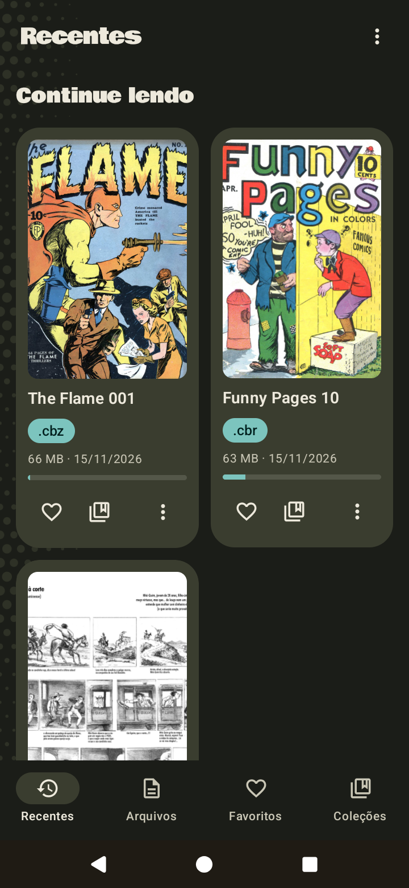
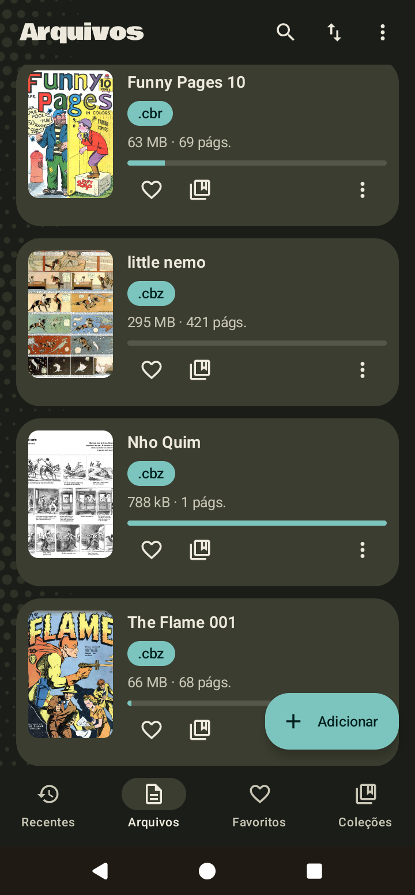
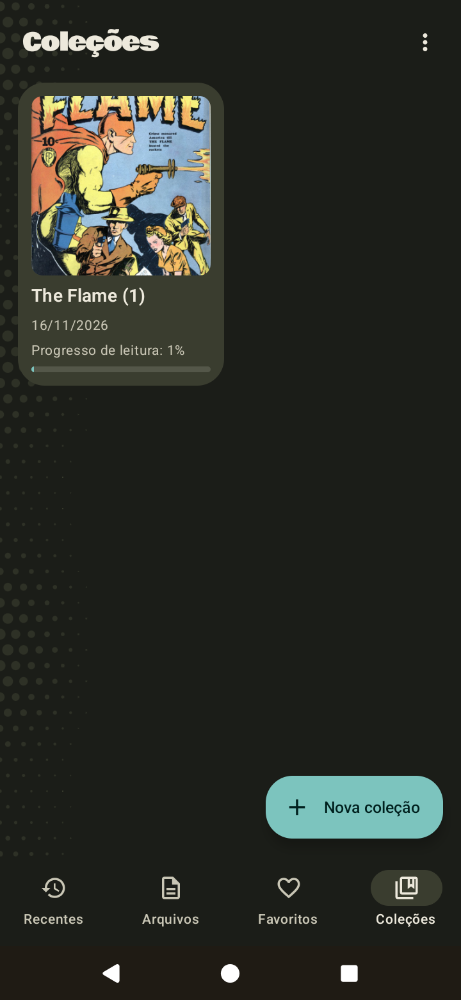
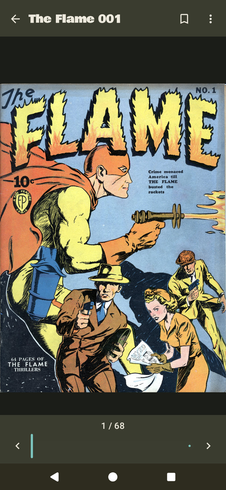
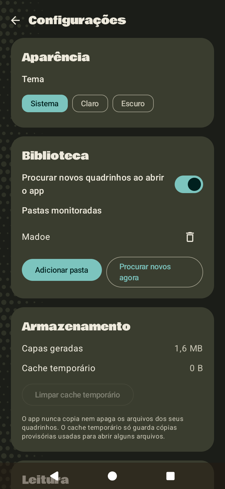
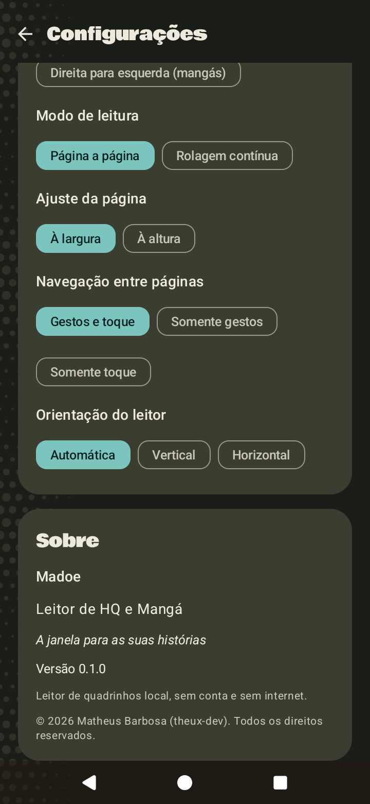
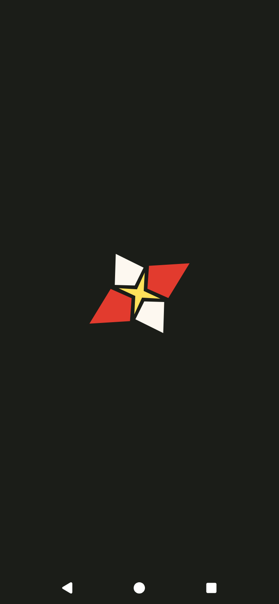
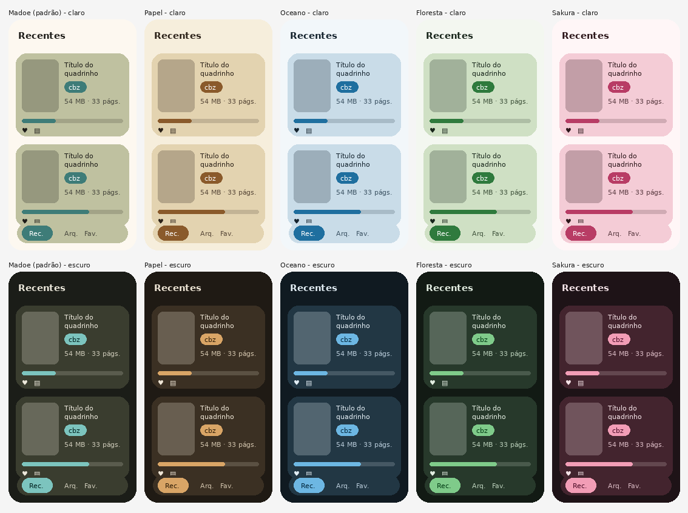
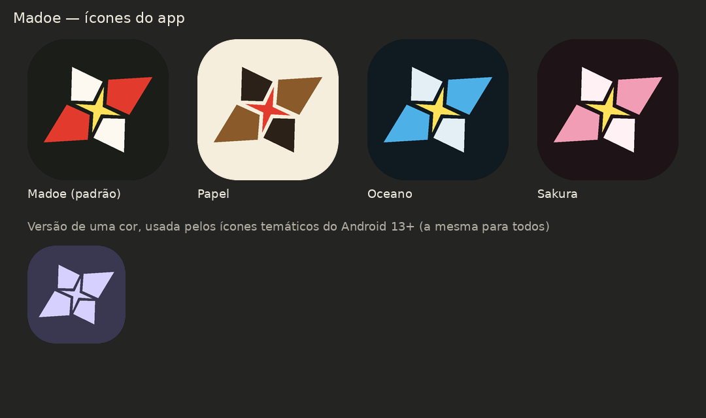

# Madoe - Leitor de HQ e Mangá

[](https://github.com/theux-dev/madoe/actions/workflows/build.yml)

> *A janela para as suas histórias.*

Android · Kotlin · Jetpack Compose · Material 3 · 100% offline

## Sobre

**Madoe** é um leitor de quadrinhos para Android que lê HQs, gibis, mangás e outros quadrinhos
guardados no próprio aparelho, sem conta, sem internet e sem anúncios. O nome combina 窓 (*mado*,
"janela") e 絵 (*e*, "imagem"): a janela pela qual você vê as histórias.

O projeto começou como um leitor pessoal, para ler HQs e mangás dentro do ônibus e do carro, e foi
crescendo até virar um aplicativo completo, com biblioteca, coleções, leitor com vários modos e
gerenciamento de arquivos. Ele é publicado aqui como projeto de portfólio.

## Funcionalidades

**Biblioteca**

- Importação de arquivos pelo seletor de documentos do Android e adição de pastas, que são
  escaneadas ao abrir o app (a varredura pode ser desligada nas configurações) ou sob demanda.
- Formatos: CBZ, CBR (RAR), CB7 (7z), CBT (TAR), ZIP, PDF e imagens soltas (JPG, PNG e WebP). O tipo
  do arquivo é detectado pelo **conteúdo**, não pela extensão: um `.cbr` que na verdade é um ZIP abre
  normalmente.
- Capas geradas a partir da primeira página; informações de formato, tamanho, páginas e progresso.
- Busca por título e ordenação por nome, adição recente ou última leitura.
- Favoritos, coleções (criar, renomear, excluir e organizar títulos), renomear títulos e
  **remover da biblioteca sem apagar o arquivo original**.
- Telas de Recentes ("Continue lendo" e "Adicionados recentemente"), Arquivos, Favoritos, Coleções e
  Detalhes do título.

**Leitor**

- Modos página a página e rolagem contínua vertical.
- Direção de leitura da esquerda para a direita (HQs) ou da direita para a esquerda (mangás).
- Ajuste da página à largura ou à altura da tela; zoom por pinça (até 5x) no modo página a página.
- Navegação por gestos, por toque nas laterais da tela e por botões; controle deslizante de páginas,
  "ir para página" e marcadores de página.
- Modo noturno, orientação do leitor (automática, vertical ou horizontal), tela cheia e tela sempre
  acesa durante a leitura.
- O progresso é salvo a cada página, e a leitura é retomada exatamente de onde parou.
- **Salvar a página como imagem** (menu ⋮ do leitor): grava na galeria, na pasta Madoe, a imagem original da
  página, sem recompressão e sem pedir nenhuma permissão (Android 10 ou mais novo). Em PDF, a página é
  renderizada em alta resolução e salva como PNG.
- Fundo do leitor ajustável: do tema, preto, cinza escuro, papel ou branco.
- Páginas ilegíveis ou corrompidas mostram um aviso com opção de tentar de novo, sem derrubar o app.

**Configurações**

- Tema claro, escuro ou do sistema; preferências de leitura salvas entre sessões.
- Paletas de cores: Madoe, Papel, Oceano, Floresta e Sakura, nos modos claro e escuro, e, no Android 12 ou
  mais novo, "Cores do sistema" (Material You). O contraste de cada paleta é conferido por testes automáticos.
- Ícone do app à escolha (Madoe, Papel, Oceano ou Sakura), com versão de uma cor para os ícones
  temáticos do Android 13 ou mais novo. A troca usa `activity-alias`, sem permissões e sem reiniciar o app.
- Gerenciamento das pastas monitoradas e do armazenamento (capas geradas e cache temporário).
- Introdução na primeira abertura.
- Tela de licenças de terceiros (em Configurações > Sobre).

## Capturas de tela

<table>
  <tr>
    <td align="center"><br><sub>Recentes</sub></td>
    <td align="center"><br><sub>Arquivos</sub></td>
    <td align="center"><br><sub>Coleções</sub></td>
    <td align="center"><br><sub>Leitor</sub></td>
  </tr>
  <tr>
    <td align="center"><br><sub>Configurações</sub></td>
    <td align="center"><br><sub>Leitura e Sobre</sub></td>
    <td align="center"><br><sub>Abertura</sub></td>
  </tr>
</table>

Capturas feitas com o tema escuro do sistema. Nas telas só aparecem capas dos quadrinhos de exemplo
(veja a seção seguinte).

### Paletas e ícones

Ilustrações montadas com as cores e o desenho reais do app (não são capturas de tela).

<p align="center"></p>
<p align="center"><sub>As cinco paletas, nos modos claro e escuro. No Android 12 ou mais novo há também "Cores do sistema", que não aparece aqui.</sub></p>

<p align="center"></p>
<p align="center"><sub>Os quatro ícones à escolha em Configurações &gt; Aparência.</sub></p>

## Quadrinhos de exemplo

O Madoe **não inclui nenhum quadrinho**. Os exemplos usados nos testes e nas demonstrações são obras
antigas, em domínio público ou indicadas como tal:

| Obra | Autor / editora | Ano | Situação |
|---|---|---|---|
| *As Aventuras de Nhô-Quim* (capítulo I) | Angelo Agostini, *Vida Fluminense* | 1869 | Domínio público (o autor morreu em 1910) |
| *Little Nemo in Slumberland* | Winsor McCay, tiras dominicais de jornais dos EUA | 1905 a 1914 | Domínio público (o autor morreu em 1934) |
| *Funny Pages* nº 10 | Centaur Publications | abril de 1937 | Indicada como domínio público pelo Digital Comic Museum e pelo Comic Book Plus. Só a capa aparece nas capturas |
| *The Flame* nº 1 | Fox Feature Syndicate | verão de 1940 | Indicada como domínio público pelo Digital Comic Museum e pelo Comic Book Plus. Só a capa aparece nas capturas |

Fontes das digitalizações:

- *Little Nemo in Slumberland*: [Internet Archive](https://archive.org/details/LittleNemo1905-14FromWinsorMccayAsCbz) (item `LittleNemo1905-14FromWinsorMccayAsCbz`).
- *As Aventuras de Nhô-Quim*: [Internet Archive](https://archive.org/details/nho-quim) (item `nho-quim`). A página usada nas demonstrações foi montada a partir dos quadros do capítulo I.
- *Funny Pages* nº 10 e *The Flame* nº 1: Digital Comic Museum e Comic Book Plus.

Se você é titular de direitos de alguma dessas obras e quer a remoção de uma imagem, abra uma *issue*.

## Tecnologias

| Área | Tecnologia |
|---|---|
| Linguagem | Kotlin 2.0.21 (JVM 17) |
| Interface | Jetpack Compose (BOM 2024.12.01), Material 3, Navigation Compose 2.8.5 |
| Arquitetura | MVVM com repositórios e injeção de dependência com Hilt 2.52 |
| Dados locais | Room 2.6.1 (biblioteca, coleções, marcadores) e DataStore 1.1.1 (preferências) |
| Arquivos | Storage Access Framework; Apache Commons Compress 1.27.1 (ZIP, TAR, 7z), XZ for Java 1.10, junrar 8.1.1 (RAR) e `PdfRenderer` do Android (PDF) |
| Imagens | Coil 2.7.0 (capas) e `BitmapFactory` com amostragem (páginas) |
| Build | Android Gradle Plugin 8.7.3, Gradle 8.9 (wrapper), KSP |
| Testes | JUnit 4, AndroidX Test, kotlinx-coroutines-test |

SDK: `minSdk` 26 (Android 8.0), `compileSdk` e `targetSdk` 35. As versões estão em
[`gradle/libs.versions.toml`](gradle/libs.versions.toml).

## Arquitetura

```
app/src/main/java/com/mangareader/app/
├── MadoeApp.kt, MainActivity.kt, MainViewModel.kt
├── data/
│   ├── db/        Room: entidades, DAOs e banco
│   ├── icon/      troca do ícone do app (activity-alias)
│   ├── library/   importação, varredura de pastas e tarefas da biblioteca
│   ├── model/     modelos e enums (formatos, configurações, progresso)
│   ├── prefs/     preferências (DataStore)
│   ├── repo/      repositórios
│   ├── source/    leitura dos formatos: uma implementação de PageSource por tipo
│   └── storage/   cache e armazenamento
├── di/            módulos do Hilt
└── ui/
    ├── components/  cartões, barras, diálogos e ações compartilhadas
    ├── navigation/  rotas e barra inferior
    ├── onboarding/  introdução
    ├── reader/      leitor, carregador de páginas com cache e diálogos
    ├── screens/     Recentes, Arquivos, Favoritos, Coleções e Detalhes
    ├── settings/    configurações
    └── theme/       cores, tipografia e formas
```

Decisões de projeto:

- **Offline e sem permissões amplas.** Os arquivos são acessados só pelo seletor de documentos do
  Android (SAF), e o app guarda apenas o URI e a permissão que o usuário concedeu. O app não altera
  os arquivos originais e não mantém cópias deles; só em casos raros, quando o provedor de
  arquivos não permite leitura direta, cria uma cópia temporária no cache, apagada em seguida.
- **Uma interface para todos os formatos.** `PageSource` entrega uma página por vez, seja de um CBZ,
  CBR, CB7, CBT, PDF ou de imagens soltas, e o leitor não precisa saber qual é o formato.
- **Pouca memória.** Cada página é decodificada reduzida e só quando pedida, e `PageLoader` mantém
  algumas páginas num cache LRU limitado por bytes. Arquivos grandes nunca são carregados por inteiro.
- **Detecção pelo conteúdo.** O tipo do arquivo vem da assinatura dos primeiros bytes, não da extensão.
- **Tarefas fora das telas.** Importações e varreduras rodam numa coroutine própria, uma de cada vez,
  e continuam se o usuário trocar de aba.
- **Ícone trocável sem permissões.** Cada ícone é um `<activity-alias>` do manifesto, e só um fica ligado. O
  `AppIconManager` liga o novo antes de desligar os outros; o estado fica guardado pelo próprio Android,
  e testes automáticos conferem que manifesto, enum e recursos continuam consistentes.
- **Banco versionado.** O esquema do Room é exportado (`room.schemaLocation`) para acompanhar a evolução.

## Características técnicas

- Funciona 100% offline. O `AndroidManifest.xml` do app não declara permissões (nenhuma de internet
  nem de acesso amplo ao armazenamento).
- O identificador do pacote continua `com.mangareader.app` e o banco continua `mangareader.db`, por
  compatibilidade com instalações existentes, mesmo depois da mudança do nome para Madoe.

## Como compilar e testar

Requisitos: JDK 17 e o Android SDK com a plataforma 35 (o Android Studio instala e configura os dois).
O projeto traz o Gradle Wrapper, então não é preciso instalar o Gradle.

```bash
git clone https://github.com/theux-dev/madoe.git
cd madoe

./gradlew assembleDebug            # gera app/build/outputs/apk/debug/app-debug.apk
./gradlew assembleRelease          # build de release (R8 e redução de recursos), sem assinatura
./gradlew testDebugUnitTest        # testes de unidade (JVM)
./gradlew connectedDebugAndroidTest  # testes instrumentados (exigem dispositivo ou emulador)
```

No Windows, use `gradlew.bat`. Se o Gradle não achar o SDK, crie `local.properties` com
`sdk.dir=/caminho/do/Android/Sdk` ou defina `ANDROID_HOME`.

Um workflow do GitHub Actions (`.github/workflows/build.yml`) roda os testes de unidade, o Android Lint
e as compilações de debug e de release a cada push e em cada pull request. O Dependabot abre pull
requests semanais quando uma biblioteca ou uma action tem versão nova. O release exercita o R8 e a
redução de recursos, e sai sem assinatura (nenhum APK é publicado). Os testes instrumentados não
rodam lá, porque exigem um emulador.

Para testar o release no celular, assine com a chave de debug, só para teste:

```bash
./gradlew assembleRelease -PdebugSignedRelease
adb install -r app/build/outputs/apk/release/app-release.apk
```

## Limitações conhecidas

- Arquivos protegidos por senha não são suportados.
- Arquivos RAR e 7z "sólidos" muito grandes podem ser lentos ao pular para páginas distantes,
  porque o formato obriga a descompactar o que vem antes.
- O zoom por pinça existe só no modo página a página; ainda não há zoom por toque duplo nem no modo
  de rolagem contínua.
- Salvar a página como imagem exige Android 10 ou mais novo; ainda não é possível compartilhá-la diretamente com outros apps.
- Se um arquivo for movido ou apagado, o leitor avisa ao tentar abri-lo e oferece remover o título,
  mas os cartões da biblioteca ainda não são marcados como indisponíveis automaticamente.
- Os testes manuais foram feitos até agora principalmente em um aparelho Android.
- O projeto não está publicado em nenhuma loja de aplicativos.

## Copyright and Usage

### Português

© 2026 Matheus Barbosa (theux-dev). Todos os direitos reservados.

Este repositório é público para fins de apresentação e consulta (portfólio). O código-fonte e os
demais materiais, incluindo o ícone e os recursos gráficos do aplicativo, não são oferecidos sob
uma licença de uso geral: **não concedo autorização geral** para copiar, modificar, redistribuir ou
explorar comercialmente o código ou qualquer parte do projeto sem a minha permissão prévia.

O que continua valendo:

- **Funcionamento do GitHub.** Como o repositório é público, aplicam-se os Termos de Serviço do
  GitHub, que permitem aos usuários da plataforma ver o repositório e usar o conteúdo dentro do
  próprio GitHub, inclusive criando *forks* pelas funcionalidades dele. Essa permissão se limita ao
  funcionamento da plataforma e não autoriza usar, modificar, redistribuir ou explorar o código
  fora dela. Valem sempre os Termos de Serviço do GitHub em vigor.
- **Direitos previstos em lei.** Permanecem os usos que a legislação permite independentemente de
  autorização (limitações e exceções aos direitos autorais).
- **Componentes de terceiros.** Bibliotecas e a fonte têm licenças próprias, que se aplicam a elas e
  não são alteradas por este aviso. Veja [`THIRD_PARTY_NOTICES.md`](THIRD_PARTY_NOTICES.md).

Este aviso **não impede tecnicamente** que alguém clone, baixe ou faça fork do repositório e **não é
uma garantia absoluta de proteção jurídica**: ele declara a minha posição sobre os direitos do
projeto. Para pedir permissão de uso, abra uma *issue* ou entre em contato pelo meu perfil no GitHub.

### English

© 2026 Matheus Barbosa (theux-dev). All rights reserved.

This repository is public for presentation and reference purposes (portfolio). The source code and
the other materials, including the app icon and graphic assets, are not offered under a general-use
license: **I do not grant general permission** to copy, modify, redistribute or commercially exploit
the code or any part of the project without my prior permission.

What still applies:

- **How GitHub works.** Because the repository is public, GitHub's Terms of Service apply. They allow
  users of the platform to view the repository and use its content within GitHub itself, including
  creating forks through GitHub's features. That permission is limited to how the platform works and
  does not authorize using, modifying, redistributing or commercially exploiting the code outside
  of it. GitHub's Terms of Service in force at any time always apply.
- **Rights granted by law.** Uses that the applicable law allows regardless of authorization
  (copyright limitations and exceptions) remain unaffected.
- **Third-party components.** Libraries and the font have their own licenses, which apply to them and
  are not changed by this notice. See [`THIRD_PARTY_NOTICES.md`](THIRD_PARTY_NOTICES.md).

This notice **does not technically prevent** anyone from cloning, downloading or forking the
repository, and it **is not an absolute guarantee of legal protection**: it states my position on
the project's rights. To ask for permission, open an issue or contact me through my GitHub profile.

## Contribuições

Sugestões, ideias e *issues* com relatos de problemas são bem-vindas. **Por enquanto, não estou
aceitando contribuições de código** (pull requests).

## Créditos

- Desenvolvido por Matheus Barbosa.
- A interface foi inspirada em referências de leitores de quadrinhos existentes, sem uso de arte,
  nome ou marca de terceiros. O ícone e o logotipo do Madoe são originais deste projeto.
- Fonte Bowlby One, de Vernon Adams (SIL Open Font License 1.1).
- Bibliotecas de código aberto listadas em [`THIRD_PARTY_NOTICES.md`](THIRD_PARTY_NOTICES.md).

Perfil: [github.com/theux-dev](https://github.com/theux-dev)
